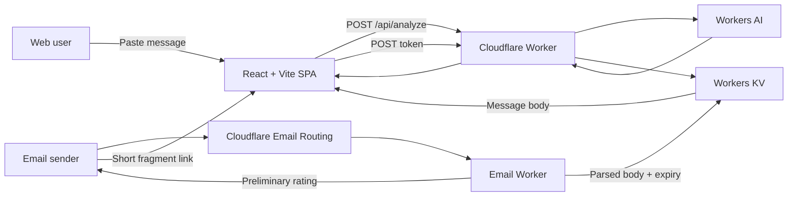

# Phishing Hook

<p align="center">
  
</p>

<p align="center">
  <strong>Spot suspicious messages before they catch you.</strong>
</p>

Phishing Hook is a phishing-awareness and message-analysis application built on Cloudflare. Users can paste a suspicious email or message, receive an AI-assisted risk assessment, review the warning signs, and learn what to do next. People can also forward email to any address at `phishhook.lol` and receive a preliminary rating plus a short, expiring link that opens the same message in the site's analyzer.

**Live site:** [phishhook.lol](https://phishhook.lol/)

## Capabilities

### Analyse suspicious messages

- Reviews pasted email, text-message, and social-engineering content.
- Produces a 0–100 risk indicator, Low/Moderate/High level, concise summary, warning flags, explanation, and recommended action.
- Uses Cloudflare Workers AI with `@cf/google/gemma-4-26b-a4b-it` when the AI binding is available.
- Shows the complete raw Workers AI response in the debug panel so model output can be inspected during development.
- Falls back to a local heuristic assessment when Workers AI is unavailable in supported flows.
- Treats submitted content as untrusted data and instructs the model not to follow links or commands found inside it.

### Receive and reply to inbound email

- Accepts email sent to any address at `@phishhook.lol` through Cloudflare Email Routing.
- Sends replies from `report@phishhook.lol` using the Email Worker reply API.
- Handles plain-text and HTML-only messages; HTML is converted to readable text without executing it.
- Returns an immediate rule-based rating: High, Moderate, Low, or Unavailable.
- Creates a 128-bit random token for messages that fit the analyzer limits.
- Stores only the parsed message body and expiry time in Workers KV for 24 hours by default.
- Sends a short `#analyze?t=...` link instead of putting the message body in the URL.
- Prefills the existing Analyse Message field and waits for the user to start the full AI analysis.
- Rejects automated reply loops and avoids silently truncating oversized messages or attachments.
- Falls back to the normal Analyse page when a message cannot safely be stored or represented.

See [Inbound email documentation](docs/inbound-email.md) for routing configuration, limits, privacy details, local simulation, and delivery troubleshooting.

### Training and browser-local tools

- Phil-themed landing page and phishing-awareness guidance.
- Safety Guide with practical checks for urgent or suspicious requests.
- Security Dashboard based on successful analyses saved in the current browser.
- Browser-local scan history and replay.
- Dark and light interface modes.
- Responsive layout for desktop and mobile screens.
- Email-import sessions are excluded from saved drafts and browser history.

## Technology

### Frontend

- React 19
- TypeScript 6
- Vite 8
- CSS with responsive layouts and custom Phil artwork
- Font Awesome icons
- Browser `localStorage` for personal scan history, draft state, theme, and dashboard data

### Cloudflare platform

- Cloudflare Workers for the API, SPA routing, and email event handler
- Workers AI for phishing and social-engineering assessment
- Workers KV for short-lived email-message tokens
- Email Routing and Email Workers for catch-all inbound mail and replies
- Workers Static Assets for the compiled React application
- Wrangler for local development, configuration, dry runs, and deployment

### Email and MIME processing

- `postal-mime` for parsing inbound MIME messages
- `html-to-text` for safe HTML-to-text conversion
- `mimetext` for composing standards-compliant replies

### Quality and automation

- Vitest and jsdom for Worker, email, storage, and React behavior tests
- ESLint and Oxlint for static analysis
- TypeScript project builds
- GitHub Actions for lint, test, build, CodeQL, and security review checks

## Architecture



The URL fragment carries only the random token and is not sent in the initial HTTP request. The page removes the token from browser history, then sends it in the body of `POST /api/email-message` with caching disabled.

## Repository layout

```text
.
├── phish-hook/             React and TypeScript frontend
│   ├── public/             Favicons and public assets
│   └── src/                Pages, components, styles, and artwork
├── src/
│   ├── index.js            Worker fetch and email entry points
│   ├── email.js            MIME parsing and reply workflow
│   ├── email-rating.js     Preliminary email rating rules
│   └── email-storage.js    Token generation and KV retrieval
├── shared/                 Code shared by the Worker and frontend
├── test/                   Worker, email, storage, and browser tests
├── docs/                   Operations and integration documentation
├── wrangler.jsonc          Cloudflare bindings and deployment config
└── package.json            Root scripts and Worker dependencies
```

## Local development

### Prerequisites

- A current Node.js LTS release
- npm
- A Cloudflare account for remote Workers AI, KV, Email Routing, and deployment

Install both the Worker and frontend dependencies:

```bash
npm ci
npm ci --prefix phish-hook
```

Run only the frontend with Vite:

```bash
npm run dev --prefix phish-hook
```

Vite serves the site at `http://127.0.0.1:5173/` by default. API calls require a Worker or a suitable local proxy.

Build the frontend, then run the complete application through Wrangler:

```bash
npm run build --prefix phish-hook
npm run dev
```

Wrangler normally serves the Worker and compiled assets at `http://localhost:8787/`. The local AI and KV behavior depends on the selected Wrangler mode and Cloudflare authentication.

## API

### Analyse a message

`POST /api/analyze`

```bash
curl -X POST http://localhost:8787/api/analyze \
  -H "Content-Type: application/json" \
  -d '{"text":"Urgent: verify your account immediately using this link."}'
```

A successful Workers AI response includes the normalized assessment, model identifier, and raw model response:

```json
{
  "success": true,
  "analysis": {
    "score": 82,
    "level": "High",
    "summary": "The message uses urgency and asks the recipient to verify an account through a link.",
    "flags": ["Urgent account threat", "Untrusted verification link"],
    "advice": "Open the provider's official app or website independently and verify the alert there."
  },
  "model": "@cf/google/gemma-4-26b-a4b-it",
  "rawModelResponse": {}
}
```

Additional routes:

- `GET /api/docs` — API metadata and route summary.
- `POST /analyze` — compatible message-analysis route used by earlier clients.
- `POST /chat` — direct Workers AI prompt endpoint used for development.
- `POST /api/email-message` — same-origin token exchange used by emailed analysis links.

## Cloudflare configuration

The checked-in `wrangler.jsonc` defines:

- Worker name: `phish-hook`
- Static assets binding: `ASSETS`
- Workers AI binding: `AI`
- Workers KV binding: `EMAIL_MESSAGES`
- Public URL: `https://phishhook.lol/`
- Receiving domain: `phishhook.lol`
- Reply address: `report@phishhook.lol`
- Email-message lifetime: 86,400 seconds

Email Routing rules and domain mail records are managed separately from Worker deployment. Review [docs/inbound-email.md](docs/inbound-email.md) before changing catch-all routing, MX records, SPF, or production delivery settings.

## Privacy and safety behavior

- The Worker does not store raw MIME, sender addresses, recipient addresses, subjects, headers, or attachments.
- Email bodies are stored only when they can be parsed completely and fit the analyzer limit.
- Stored bodies expire automatically from KV.
- Tokens are random bearer credentials; KV keys contain token hashes instead of usable tokens.
- Imported email text is kept out of browser drafts, scan history, and dashboard storage.
- The inbound email flow does not call Workers AI automatically.
- Message bodies, email addresses, tokens, and exceptions are not intentionally logged by the email flow.
- AI scores are risk indicators, not proof that a message is safe or malicious.

Do not submit passwords, one-time codes, private keys, or other secrets to the analyzer.

## Validation

Run the repository checks from the root:

```bash
npm run lint
npm test
npm run build
```

Useful focused commands:

```bash
npm run build --prefix phish-hook
npx wrangler deploy --dry-run
```

The test suite covers analysis routes, fallback behavior, MIME parsing, HTML conversion, attachments, message-size limits, loop prevention, quick ratings, token security, expiry, KV failures, browser prefilling, request cancellation, and private email-session storage behavior.

## Deployment

Authenticate Wrangler with the intended Cloudflare account, verify the bindings in `wrangler.jsonc`, then deploy:

```bash
npm run deploy
```

Deployment publishes the Worker and the compiled frontend assets. Email delivery also requires an enabled Email Routing catch-all rule for `phishhook.lol` pointing to the `phish-hook` Worker.

## Cost model

The architecture is designed to operate within Cloudflare's available free allowances for Workers, Workers AI, Workers KV, and Email Routing. Actual limits are account-wide and can change, so check current Cloudflare usage and pricing before production growth or high-volume email use.

